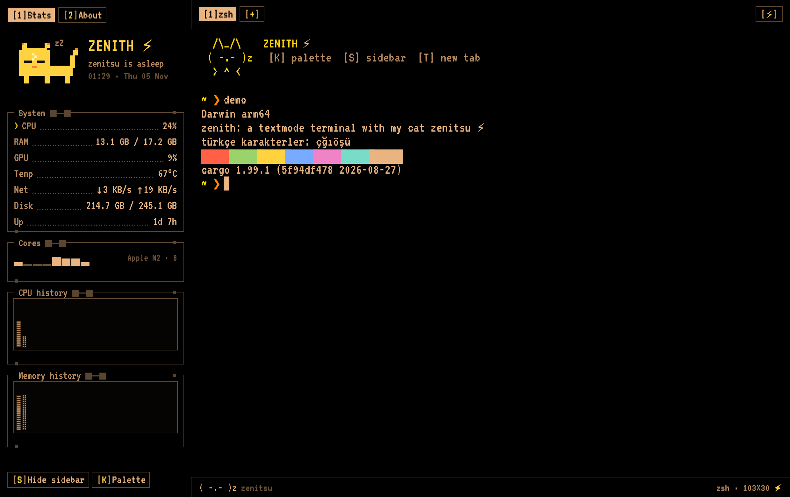

# zenith ⚡

A textmode terminal with my cat Zenitsu, written in Rust.



Zenith is a real terminal emulator (it runs your shell in a PTY and parses output with the same engine as Alacritty) wrapped in a retro textmode interface: black background, sand-coloured pixel text, one-pixel frames with little square knobs, bracketed hotkeys and dotted leader rows.

On the left lives a live system panel. On top of it sits a pixel-art Zenitsu who dozes with a little `zZz` while the machine is idle, wakes up when the CPU gets busy, and flinches with a ⚡ when lightning strikes (click the cat or the `[⚡]` button).

## Features

- **Real terminal:** your login shell in a PTY, 256-colour and truecolor, 10,000 lines of scrollback, alternate screen, UTF-8.
- **Tabs:** `⌘T` new, `⌘W` close, `⌘1`–`⌘9` switch.
- **Selection and copy:** drag to select, double-click for a word, triple-click for a line, `⌘A` for everything, `⌘C` to copy. With nothing selected, `⌘C` sends `Ctrl+C` to the program, like a classic terminal.
- **Mouse for programs:** programs that ask for the mouse (`vim`, `tmux`, `htop`…) get clicks, drags and the wheel. Hold `Shift` to select text yourself.
- **Bracketed paste:** pasted text is fenced so shells and editors can tell it from typing, and it cannot smuggle its own end marker.
- **Links:** `⌘`-click an `http(s)` URL in the output to open it.
- **System sidebar:** CPU, RAM, GPU, temperature, network, disk, uptime, per-core bars and dithered history "skylines". `⌘S` hides it.
- **Command palette:** `⌘K`.
- **Pixel Zenitsu:** sleeping, awake and startled states.

## Keys

| Key | Action |
| --- | --- |
| `⌘T` / `⌘W` | New / close tab |
| `⌘1`–`⌘9` | Switch tab |
| `⌘K` | Command palette |
| `⌘S` | Toggle sidebar |
| `⌘C` | Copy selection (or send `Ctrl+C`) |
| `⌘A` | Select all |
| `⌘+` / `⌘-` | Bigger / smaller font |
| `⌘`-click | Open link |
| `Shift`+drag | Select text while a program uses the mouse |

## Build and run

You need a recent stable [Rust toolchain](https://rustup.rs).

```sh
git clone https://github.com/makio-san/zenith.git
cd zenith
cargo run --release
```

Zenith is developed and tested on macOS (Apple Silicon). The GPU reading uses `ioreg` and the font fallbacks point at macOS system fonts, so other platforms are untested.

## Status

Early stage. It runs a shell and everyday commands well, but it is not a daily-driver replacement yet.

Known gaps:

- Box-drawing characters are drawn from the pixel font and look uneven, which shows in `tmux` and `htop` borders. Drawing them procedurally is planned.
- No split panes, search, config file or themes yet.
- Mouse reporting, bracketed paste and link detection have unit tests, but full-screen programs have not been tried by hand yet.
- Input method editors (IME) are untested.

## Privacy

Zenith does not show your hostname or IP address anywhere in its own interface. Your shell prompt, command history and process lists still show whatever your shell and programs print, so check a screenshot before sharing it.

## Development

Some environment variables help with automated checks and screenshots:

| Variable | Effect |
| --- | --- |
| `ZENITH_SHOT=path.png` | Save a frame of the window to a PNG and quit |
| `ZENITH_SHOT_AT=4.0` | Seconds to wait before the frame is saved (default 2.4) |
| `ZENITH_DEMO="cmd"` | Type a command into the first tab one second after start |

```sh
cargo test
```

## Credits

- Pixel font: [VT323](https://fonts.google.com/specimen/VT323) by Peter Hull, under the SIL Open Font License 1.1 (see `assets/VT323-OFL.txt`).
- Terminal engine: [`alacritty_terminal`](https://crates.io/crates/alacritty_terminal). UI: [`egui`](https://github.com/emilk/egui). PTY: [`portable-pty`](https://crates.io/crates/portable-pty). Stats: [`sysinfo`](https://crates.io/crates/sysinfo).
- Zenitsu is a real cat. The name comes from a lightning-fast character who sleeps through everything.
